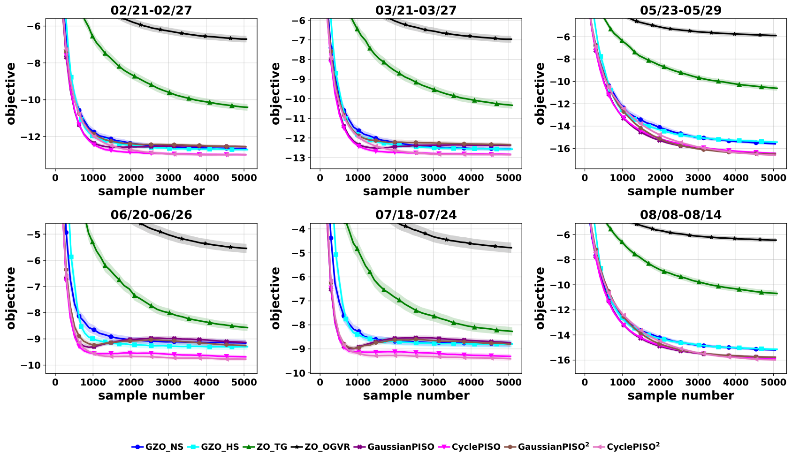
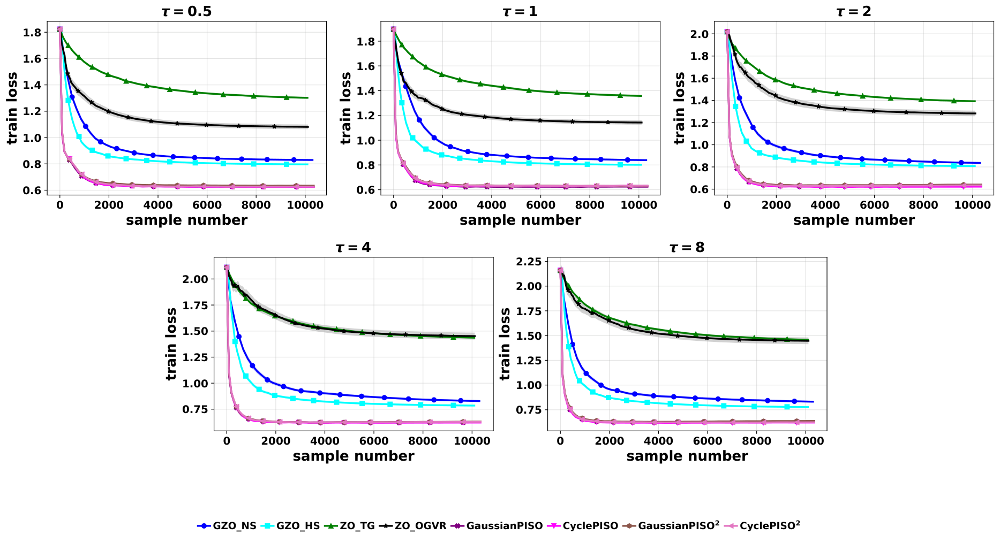
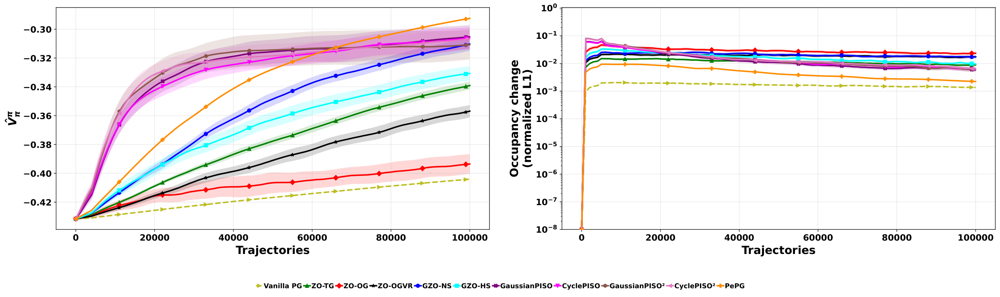
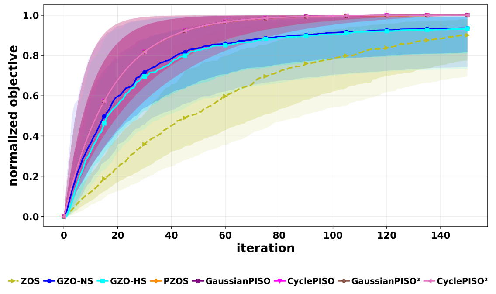
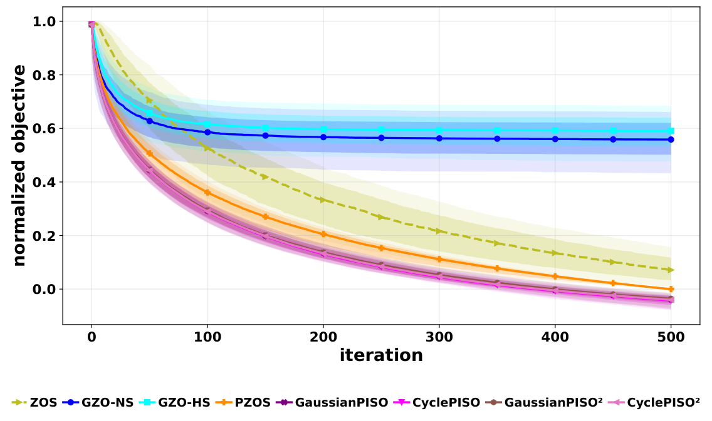

# PISO: Partially Informed Stochastic Optimization

Code for [**Partially Informed Stochastic Optimization via Zeroth-Order Residual Tracking**](https://arxiv.org/pdf/2610.13871).

Many optimization problems give direct access to only part of the gradient:

$$\nabla F(x) = g_K(x) + g_U(x),$$

where the *known* component $g_K$ can be sampled and the *unknown* component $g_U$ is visible only through noisy function values. This structure appears in

- **performative prediction**, where the deployed model shifts the data distribution (pricing, strategic classification),
- **performative reinforcement learning**, where the environment reacts to the deployed policy,
- **bilevel optimization with a black-box lower level**, where a leader optimizes against followers' equilibrium response (toll setting, security games).

PISO keeps a running estimate $m_k$ of the residual $v(x) = \nabla F(x) - \gamma g_K(x)$ and centres every two-point zeroth-order observation on it, so each query measures how wrong the current estimate is instead of re-estimating $g_U$ from scratch. The probing variance then scales with the tracking error rather than with $\|g_U\|$. One update uses **one probe direction, two function evaluations and one known-component sample**:

```
D_k     = [F(x_k + μ u_k) − F(x_k − μ u_k)] / (2μ)        two-point directional derivative
R_k     = m_k + (D_k − ⟨γ ĝ_K(x_k) + m_k, u_k⟩) u_k        residual observation centred on m_k
m_{k+1} = ρ m_k + (1 − ρ) R_k                              residual tracking
h_{k+1} = ρ_K h_k + (1 − ρ_K) ĝ_K(x_k)                     known-component average
G_k     = γ h_{k+1} + λ R_k + (1 − λ) m_{k+1}              λ = 0: PISO,  λ > 0: PISO²
x_{k+1} = x_k − η_k G_k
```

The paper proves $O(d^2\varepsilon^{-6})$ (and $O(d^2\varepsilon^{-5})$ under a Lipschitz Hessian) function-evaluation complexity without a bound on the unknown gradient, and predicts the best momentum $\rho^\star = 1 - 1/c_d$. Every experiment runs four variants: **GaussianPISO** and **CyclePISO** (probes cycling through a random orthonormal frame), each with $\lambda = 0$ (PISO) and $\lambda > 0$ (PISO²).

## Installation

Python 3.11 or newer (tested with 3.12).

```bash
git clone <this repository> PISO
cd PISO
pip install -r requirements.txt
```

## Reproducing the results

Each command runs one experiment with the paper's configuration and writes CSV tables and figures to `results/<experiment>/`:

```bash
python main.py pricing                   # pricing figure            -> results/pricing/pricing.pdf
python main.py classification            # classification figure + summary.csv (test loss and accuracy)
python main.py routing --jobs 8          # routing_trajectories.pdf, routing_pairwise_*.pdf
python main.py security --jobs 8         # security_trajectories.pdf, security_by_dimension.pdf
python main.py rl --jobs 8               # rl.pdf
python main.py ablations --jobs 8        # components, γ, ρ, ρ_K, λ and cycle-length ablations
```

`--jobs` runs independent runs in parallel. Pricing and classification run sequentially, because their baselines share one random stream. Every finished run is stored under `results/<experiment>/runs/`, so an interrupted experiment resumes where it stopped and re-running only rebuilds the tables and figures. Any config entry can be overridden for a quick check:

```bash
python main.py pricing --set experiment.simulations=3 "experiment.weeks=['08','12']"
python main.py rl --set "experiment.seeds=[100,101]" experiment.max_trajectories=5000
```

| Experiment | Setting | Budget |
|---|---|---|
| `pricing` | 6 weeks × 100 simulations, 10 products, 40 buyers | 5,000 samples |
| `classification` | 5 values of τ × 100 simulations | 10,000 samples |
| `routing` | 225 random toll networks | 150 iterations |
| `security` | 427 security games, $d_x \in [2, 300]$ | 500 iterations |
| `rl` | 20 seeds | 100,000 trajectories |
| `ablations` | pricing, 6 weeks × 100 simulations per variant | 5,000 samples |

All hyperparameters are in `configs/`; the tuning grids are listed in the appendix of the paper. The known-component momentum is $\rho_K = 0$ (a fresh known estimate) everywhere except performative RL, which uses $\rho_K = 0.9$, and the $\rho_K$ ablation. The known state starts at $h_0 = \hat g_K(x_0)$.

## Baselines

| Setting | Baselines |
|---|---|
| Pricing, classification | GZO-NS and GZO-HS (guided ZO with the known component), ZO-TG (two-point Gaussian), ZO-OGVR (one-point with variance reduction) |
| Routing, security | ZOS (two-point ZO), PZOS (exact leader gradient + ZO follower response), GZO-NS, GZO-HS |
| Performative RL | Vanilla PG, ZO-TG, ZO-OGVR, GZO-NS, GZO-HS, PePG (privileged: exact response derivatives) |

## Results

**Multiproduct pricing** (6 weekly instances, $d = 10$, 100 simulations; lower is better). The cycling PISO variants reach the lowest objective on every instance.



**Strategic classification** (credit data, $d = 12$, 100 simulations): training loss against samples for each response strength $\tau$, followed by test loss / test accuracy (%) after 10,000 samples.



| Method | τ = 0.5 | τ = 1 | τ = 2 | τ = 4 | τ = 8 |
|---|---|---|---|---|---|
| GZO-NS | 0.891 / 59.1 | 0.912 / 60.8 | 0.899 / 63.2 | 0.879 / 65.0 | 0.878 / 65.7 |
| GZO-HS | 0.846 / 57.2 | 0.862 / 59.8 | 0.865 / 62.0 | 0.835 / 63.7 | 0.821 / 65.0 |
| ZO-TG | 1.428 / 45.4 | 1.487 / 46.0 | 1.505 / 45.8 | 1.558 / 44.6 | 1.580 / 44.1 |
| ZO-OGVR | 1.181 / 51.4 | 1.243 / 52.8 | 1.383 / 54.3 | 1.539 / 54.9 | 1.534 / 56.4 |
| GaussianPISO | 0.624 / **66.6** | **0.620** / 67.6 | 0.632 / 67.7 | 0.622 / **69.3** | 0.631 / 69.0 |
| CyclePISO | **0.622** / 66.6 | 0.627 / **67.6** | **0.620** / **68.3** | **0.619** / 69.0 | **0.618** / 69.5 |
| GaussianPISO² | 0.632 / 66.2 | 0.629 / 66.8 | 0.641 / 67.6 | 0.628 / 68.2 | 0.636 / 69.0 |
| CyclePISO² | 0.623 / 66.5 | 0.632 / 67.0 | 0.632 / 68.0 | 0.627 / 68.9 | 0.621 / **69.7** |

**Performative RL** (8×8 gridworld, 20 seeds). PISO and PISO² make the fastest progress among methods that only query the environment. PePG is a privileged reference that is given the exact response Jacobians.



**Bilevel games** (per-instance normalized objective; median with interquartile and 10–90% bands). Routing (225 instances, maximization): PISO reaches the same endpoint as PZOS, earlier than the guided baselines. Security (427 instances, minimization): PISO stays below PZOS throughout.

<p align="center">
  
  
</p>

## Acknowledgements

The pricing and strategic-classification setups follow the guided zeroth-order experiments of Hikima and Takeda. The gridworld comes from the performative RL benchmark of Mandal et al. The routing and security games follow Fischer et al. The credit dataset is from [Yeh and Lien (2009)](https://archive.ics.uci.edu/dataset/350/default+of+credit+card+clients), as processed in [actionable-recourse](https://github.com/ustunb/actionable-recourse).

## Citation

```bibtex
@article{chayti2026piso,
  title   = {Partially Informed Stochastic Optimization via Zeroth-Order Residual Tracking},
  author  = {Chayti, El Mahdi and Mirrokni, Alireza and Jaggi, Martin},
  journal = {arXiv preprint arXiv:2610.13871},
  year    = {2026}
}
```
